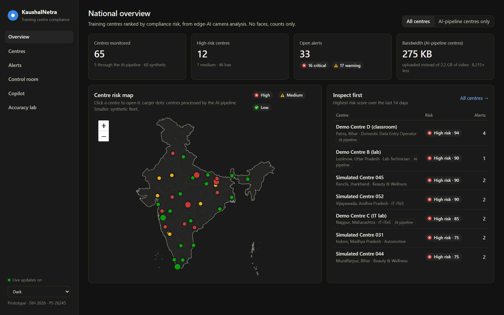
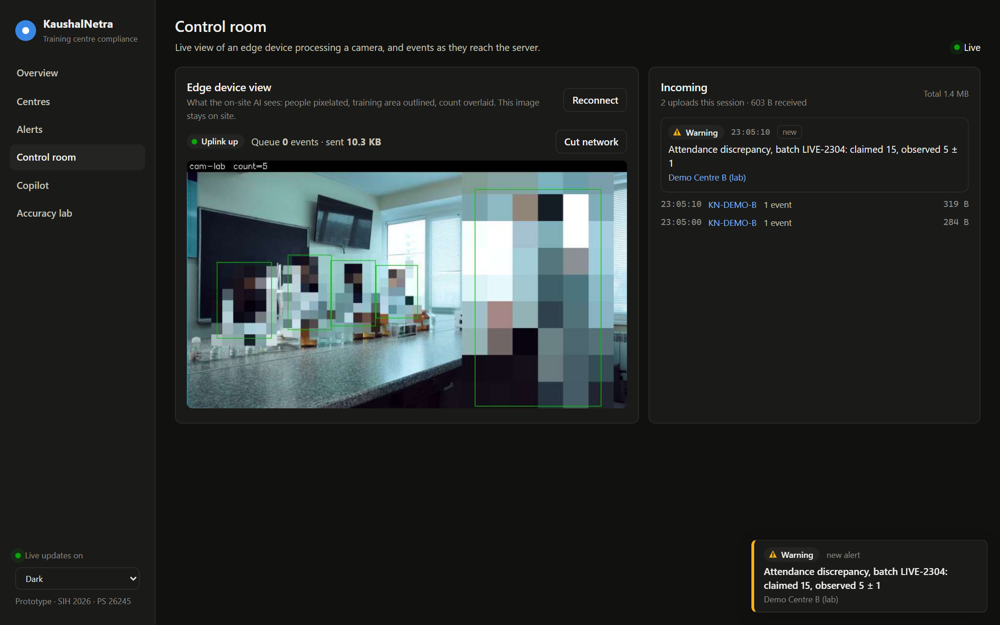
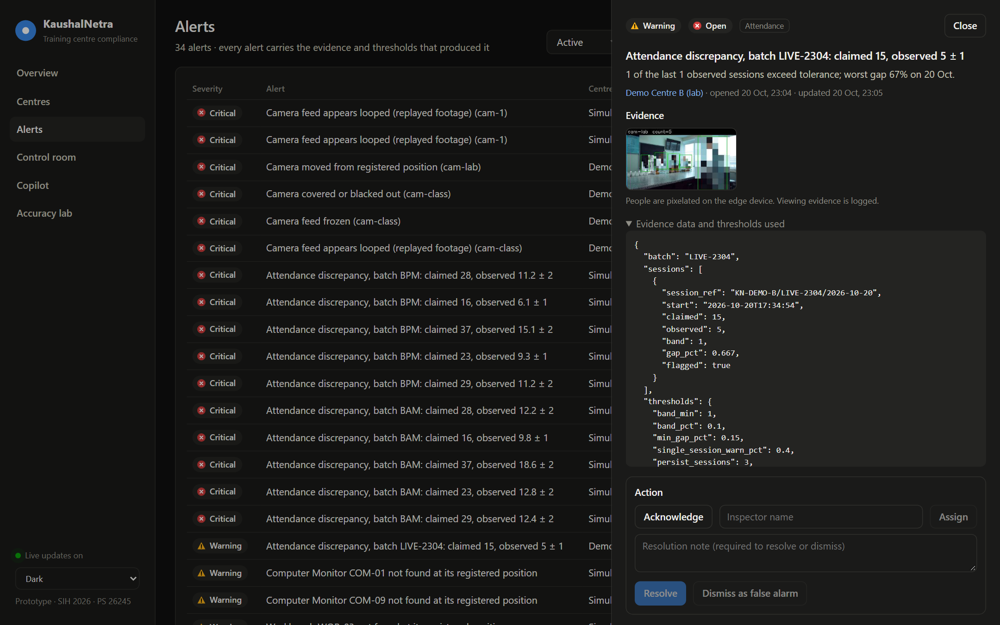
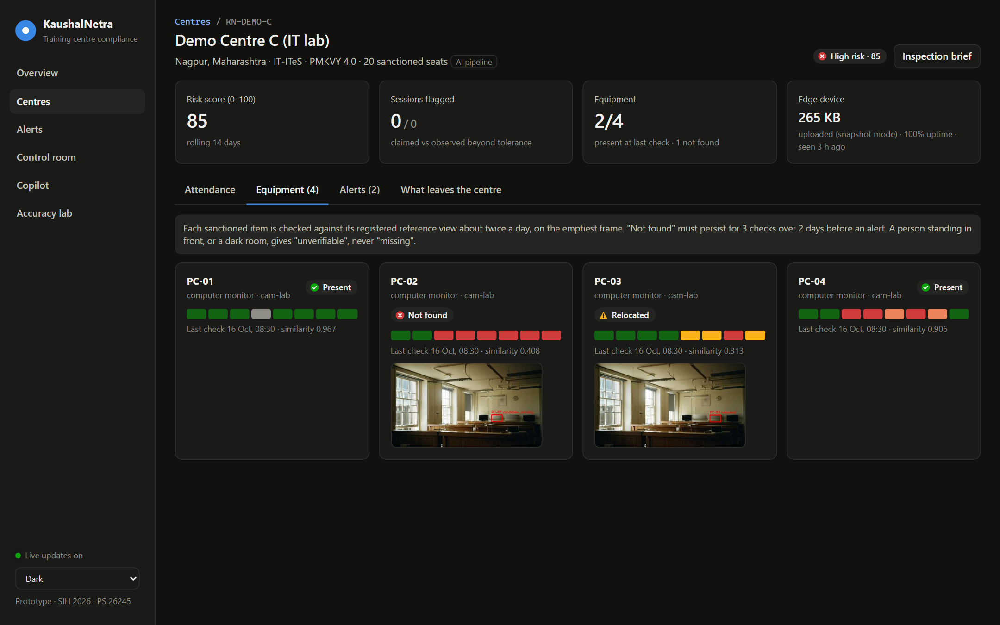
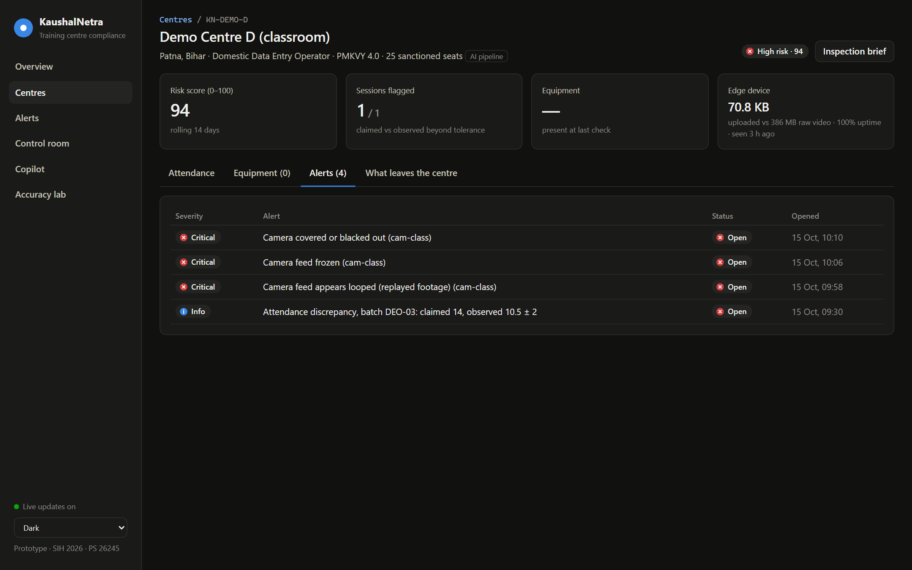
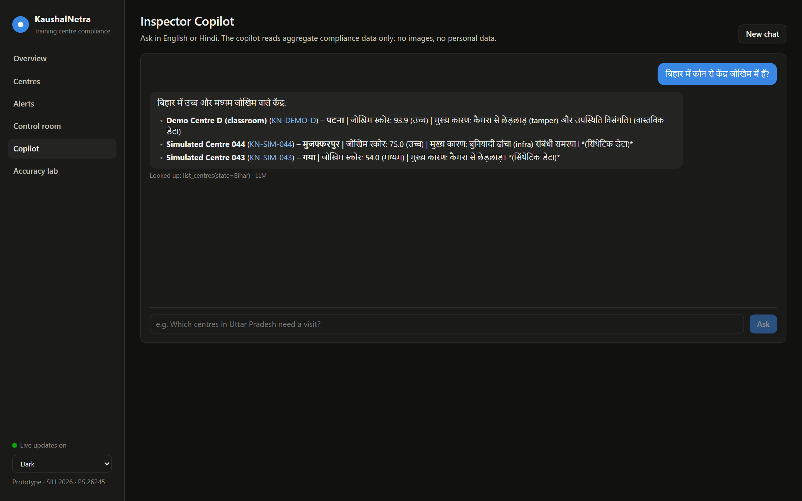
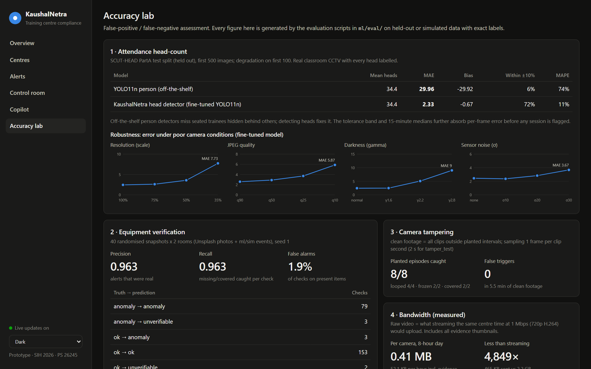
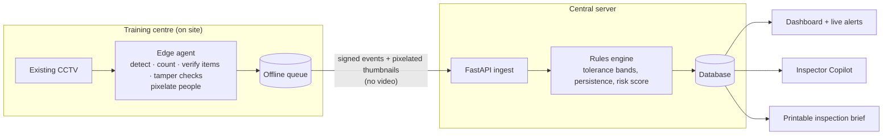

# KaushalNetra: AI Compliance Monitoring for Training Centres

> SIH 2026 · Problem Statement **26245** · Ministry of Skill Development and Entrepreneurship (MSDE) · Theme: Smart Education

**Live demo: https://kaushalnetra.onrender.com**
(free hosting: if nobody has visited for 15 minutes, the first load takes about a minute to wake the server)



KaushalNetra turns the CCTV cameras that already exist in government-funded training centres into compliance sensors. A small edge device at each centre analyses the camera feeds on site. It then sends only compact, privacy-safe events to a central dashboard:

- **Attendance discrepancies:** the observed head-count is checked against the attendance the centre submitted.
- **Infrastructure gaps:** sanctioned equipment that is missing, relocated or never used.
- **Camera tampering:** feeds that are looped, frozen, covered or moved.

No face recognition is used anywhere. Raw video never leaves the centre.

## Why it matters

- Physical inspections happen only periodically. Ghost attendance and missing equipment between visits go unnoticed.
- KaushalNetra flags problems as they happen and ranks centres by risk, so inspectors visit the right centres first.

## See it working

### Live edge AI, with privacy built in
Press **Start live run** in the Control room to run the real edge pipeline on a demo centre's footage. People are pixelated on the device; only the count leaves. Here the centre claimed 15 trainees, the camera sees 5, and the alert arrives within seconds.



### Every alert carries its evidence
A pixelated evidence image, the observed values and the exact thresholds that fired. Inspectors acknowledge, assign, resolve or dismiss each alert, so every decision stays with a person.



### Equipment checks that don't cry wolf
Each sanctioned item is matched against its registered reference view. "Not found" must persist for 3 checks over 2 days before it becomes an alert; an item moved to another desk is reported as *relocated*; a person standing in front gives *unverifiable*, never *missing*.



### Tamper detection
Replayed footage, frozen feeds, covered lenses and moved cameras are all caught and raised as critical.



### Inspector Copilot, in Hindi or English
Officers ask questions in plain language. The copilot looks up aggregate compliance data only (no images, no personal data) and shows which lookups it made. Without an LLM key it still answers in offline mode.



### Measured, not claimed
Every number in the Accuracy lab is produced by the evaluation scripts in `ml/eval/` on held-out or exactly-labelled data.



| What | Result |
|---|---|
| Head-count error (SCUT-HEAD, 500 unseen classroom frames, ~34 people each) | MAE **29.96 → 2.33** (off-the-shelf person detector vs our fine-tuned head detector) |
| Equipment verification (276 labelled checks) | precision **0.96**, recall **0.96**, 1.9% false alarms per check |
| Camera tampering (planted episodes) | **8 / 8** caught, **0** false triggers in 5.5 min of clean footage |
| Bandwidth | **0.41 MB** per camera per 8-hour day, about **4,800×** less than streaming video |

## How it works



- **Edge first.** Inference runs at the centre. Events queue on the device and upload when the link returns, so rural connectivity drops lose nothing (try **Cut network** in the Control room).
- **Few false alarms.** 15-minute median counts, a tolerance band, and persistence across sessions before an alert is raised.
- **Risk ranking.** Attendance gaps, missing or unused equipment, tampering and device downtime combine into one score per centre.

## Privacy

- No face recognition, no identities, no tracking across sessions.
- People are pixelated on the edge device before any image is stored; raw video never leaves the centre.
- The server receives counts, item states and small pixelated evidence thumbnails only. Viewing evidence is logged.
- Each centre's **What leaves the centre** tab shows exactly what was uploaded.

## Repository layout

```
SIH/
├── README.md            ← you are here
├── edge/                ← edge agent (Python): capture, inference, event queue
├── server/              ← FastAPI backend: ingest, rules engine, REST API
├── dashboard/           ← React + Vite monitoring dashboard
├── ml/                  ← training, evaluation, accuracy assessment
├── configs/             ← centre configs and rule thresholds
├── deploy/web/          ← Docker image for the hosted demo
├── assets/screenshots/  ← images used in this README
├── data/                ← sample / simulated footage (git-ignored)
└── scripts/             ← dev utilities, demo seeding, degradation simulator
```

## Tech stack

| Layer | Choice |
|---|---|
| Detection | Ultralytics YOLO (head/person), YOLO-World (open-vocabulary equipment) |
| Tracking | ByteTrack (session-scoped IDs only) |
| Item verification | DINOv2-small embeddings + per-item calibrated thresholds |
| Video / CV | OpenCV (RTSP capture, ORB alignment, MOG2 motion, CLAHE) |
| Edge runtime | PyTorch on a laptop; ONNX Runtime on small hosts (same exported model) |
| Backend | FastAPI, SQLAlchemy, SQLite (demo) → PostgreSQL (production) |
| Dashboard | React, Vite, TypeScript, Recharts, Leaflet |
| Copilot | any OpenAI-compatible LLM endpoint (Gemini in the demo), with an offline fallback |

## Quick start

```bash
# one-time setup (Python 3.12 + Node 20+)
uv venv --python 3.12 .venv
uv pip install --python .venv/Scripts/python.exe torch torchvision --index-url https://download.pytorch.org/whl/cpu
uv pip install --python .venv/Scripts/python.exe -r edge/requirements.txt -r server/requirements.txt
cd dashboard && npm install && npm run build && cd ..

# run the whole demo: API + dashboard on http://127.0.0.1:8000 (seeds the demo database on first run)
.venv/Scripts/python scripts/demo.py
```

Then open **Control room** and press **Start live run** to play a centre's footage live through the edge AI. You can also start a run from a second terminal: `.venv/Scripts/python scripts/demo.py live b`.

| What | Command |
|---|---|
| Re-seed the demo from scratch | delete `server/var`, then `python scripts/seed_demo.py` |
| Equipment / tamper / count / bandwidth evaluations | `python ml/eval/infra_eval.py`, `tamper_eval.py`, `count_eval.py --head <weights>`, `bandwidth_eval.py` |
| Regenerate the simulated equipment scenario | `python scripts/make_centre_c.py` |
| Dashboard dev server (hot reload) | `cd dashboard && npm run dev` → http://127.0.0.1:5173 |
| AI copilot with an LLM (optional, free tiers) | set `KNETRA_LLM_BASE_URL`, `KNETRA_LLM_API_KEY`, `KNETRA_LLM_MODEL` (any OpenAI-compatible endpoint); without them the copilot answers offline |

## Deploying the hosted demo

The hosted demo is one Docker container (API, dashboard, a pre-seeded database and the edge agent) sized for a free 512 MB instance. It runs on Render's free plan from a Docker Hub image.

```bash
# 1. export the detector to ONNX (once) and assemble the build folder (never includes .env)
yolo export model=yolo11n.pt format=onnx imgsz=640 simplify=True
.venv/Scripts/python scripts/build_web.py --db <freshly seeded server var folder>

# 2. build and publish the image, then redeploy it on Render
docker build -t <dockerhub-user>/kaushalnetra:latest deploy/web/build
docker push <dockerhub-user>/kaushalnetra:latest
```

On the host, set `KNETRA_LLM_BASE_URL`, `KNETRA_LLM_API_KEY` and `KNETRA_LLM_MODEL` for the copilot, and a random `KNETRA_EDGE_SECRET` so only the container's own edge agent can post events. The data resets to the seeded demo whenever the service restarts.

## Data sources (all free)

| Data | Use | Licence |
|---|---|---|
| SCUT-HEAD PartA (2,000 classroom CCTV frames, 67k labelled heads) | train + evaluate the head detector | free for academic research |
| Mixkit stock clips (classroom, labs) | AI-pipeline demo centres A, B, D | Mixkit Stock Video Free License |
| Unsplash room photos | equipment scenarios (`ml/sim`) with exact ground truth | Unsplash License |
| OpenCV `vtest.avi` | smoke + tamper tests | OpenCV sample data |
| DataMeet India boundaries | dashboard map (official composite boundary) | CC BY 4.0 |

Sixty of the 65 centres in the demo are simulated to show the system at scale. They are labelled as synthetic everywhere in the dashboard, and no accuracy figure is computed from them.
